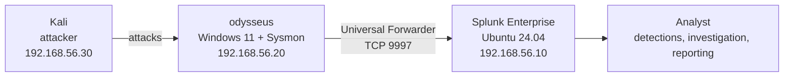

# SOC Home Lab: Detection Engineering with Splunk and Sysmon

A self-built Security Operations Center lab for generating attack telemetry, writing and tuning detections mapped to MITRE ATT&CK, and investigating incidents end to end. The lab finishes with an OT extension (Modbus TCP) and incident reporting framed against NIS2 Article 23.

## Architecture



| Component | Role | Details |
|---|---|---|
| `splunk` | SIEM | Ubuntu Server 24.04.5, Splunk Enterprise 10.6 (developer license), 4 GB RAM |
| `odysseus` | Monitored endpoint | Windows 11 Enterprise (evaluation), Sysmon 15.22, Splunk Universal Forwarder |
| `kali` | Attacker | Planned |

Networking: each VM has a NAT adapter for internet access and a host-only adapter (`192.168.56.0/24`) for lab traffic. All lab addresses are static.

## Status

- [x] Lab network and Splunk server
- [x] Sysmon telemetry from Windows endpoint into Splunk, parsed with the Splunk Add-on for Sysmon
- [ ] Attacker VM and Atomic Red Team
- [ ] Detections mapped to MITRE ATT&CK
- [ ] Incident scenario and report (incl. NIS2 Article 23 reporting timeline)
- [ ] OT extension: Modbus TCP monitoring with Zeek

## Detections

| ATT&CK ID | Technique | Detection | Status |
|---|---|---|---|
| T1059.001 | PowerShell | Encoded PowerShell command lines | Planned |
| T1003.001 | LSASS memory | Process access to `lsass.exe` (Sysmon EID 10) | Planned |
| T1566 | Phishing | Office application spawning a shell | Planned |
| T1543 / T1053 | Persistence | New service or scheduled task creation | Planned |
| T1110 | Brute force | Repeated failed logons from one source | Planned |
| T1087 | Account discovery | Burst of discovery commands in a short window | Planned |

Each detection is documented in [`detections/`](detections/) with its SPL, test method, results and tuning notes.

## Repository layout

| Path | Contents |
|---|---|
| [`configs/`](configs/) | Configuration files needed to rebuild the lab |
| [`detections/`](detections/) | One file per detection |
| [`incident-report/`](incident-report/) | End-to-end investigation of a simulated attack chain |
| [`ot-extension/`](ot-extension/) | Modbus TCP monitoring and detections |
| [`troubleshooting.md`](troubleshooting.md) | Problems encountered during the build, with causes and fixes |

## Verifying the pipeline

```spl
index=sysmon | stats count by source, EventCode
```

```spl
index=sysmon EventCode=1 | table _time Image CommandLine ParentImage
```
